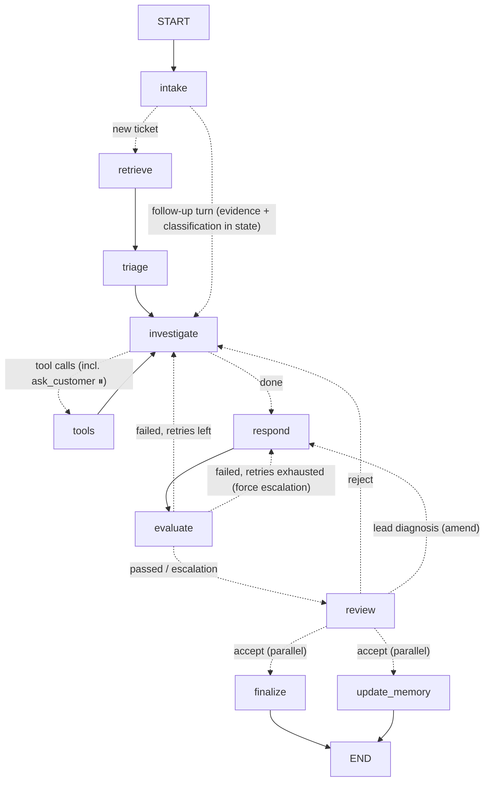

# Autonomous Support Investigation Agent

A locally runnable **LangGraph** agent that investigates new support tickets using ~28K historical
English tickets (`Tobi-Bueck/customer-support-tickets`). It retrieves and compares historical cases
(**Qdrant**, hybrid dense + BM25), calls tools it chooses itself, loads skills on demand, keeps
short- and long-term memory, asks the customer for clarification when it needs to (interrupt/resume),
checks its own answer against the evidence, and adds accepted resolutions back into the knowledge base.

| Layer | Choice |
|---|---|
| Orchestration | LangGraph 1.x: `StateGraph`, SQLite checkpointer, SQLite store, `interrupt` / `Command(resume)` |
| LLM | Groq: `openai/gpt-oss-120b` (investigation, tool calls, drafting) + `openai/gpt-oss-20b` (triage, judge, memory) |
| Vector DB | Qdrant (embedded local mode by default, Docker/Cloud via `QDRANT_URL`) |
| Embeddings | Local fastembed: `BAAI/bge-small-en-v1.5` (dense) + `Qdrant/bm25` (sparse), fused with RRF |
| Structured DB | SQLite: historical tickets, live cases, event log |
| API / UI | FastAPI + Server-Sent Events; one-page UI that shows the live graph, trace and result |
| Evaluation | LangSmith `evaluate()` with 7 evaluators on a held-out split (local fallback without a key) |

---

## 1. Quick start

```bash
# 1) environment (Python 3.11)
python -m venv .venv
.venv\Scripts\activate            # Windows   (source .venv/bin/activate on macOS/Linux)
pip install -r backend/requirements.txt

# 2) secrets: copy the template to the project root and add your keys (LangSmith key is optional)
copy .env.example .env                   # cp on macOS/Linux
#    (LLM_MAIN / LLM_FAST are accepted as aliases of GROQ_MODEL / GROQ_FAST_MODEL)

# 3) ingest + index the dataset (downloads CSVs, ~25-45 min of local CPU embedding for 23.6K tickets)
cd backend
python scripts/ingest.py                 # or --limit 3000 for a quick run
#    With QDRANT_URL set, ingest writes straight to the server. Alternative: index into the embedded store
#    first (leave QDRANT_URL empty), then copy it to the cloud without re-embedding:
python scripts/sync_qdrant.py

# 4) run the API + UI
uvicorn app.api:app --port 8000          # open http://localhost:8000

# 5) scripted demo of the 4 required paths (stop the server first if Qdrant runs embedded)
python scripts/demo.py

# before a live demo: drop resolutions indexed by rehearsals (accepted answers are indexed as trusted
# cases, so a rehearsed vague ticket would be answered from its own earlier copy instead of asking)
python scripts/reset_live_cases.py --yes

# 6) evaluations (LangSmith if LANGSMITH_API_KEY is set, otherwise local report)
python -m evals.run_evals            # both suites; --suite heldout --n 5 for a quick run
```

Optional Qdrant server (lets the API, demo and evals run at the same time, and gives you the Qdrant dashboard):

```bash
docker run -p 6333:6333 -v qdrant_storage:/qdrant/storage qdrant/qdrant
# .env -> QDRANT_URL=http://localhost:6333, then re-run scripts/ingest.py
```

---

## 2. Architecture

```
          ┌────────────── frontend (index.html + app.js) ──────────────┐
          │ ticket form · live graph · trace · clarify/review · result │
          └───────────────▲───────────────────────┬────────────────────┘
                 SSE events│                       │REST
          ┌───────────────┴───────────────────────▼────────────────────┐
          │ FastAPI (app/api.py) -> service.py (stream / resume / ...) │
          └───────────────┬────────────────────────────────────────────┘
                          │
          ┌───────────────▼──────────── LangGraph (app/graph.py) ──────┐
          │ nodes.py · tools.py · skills/*.md · llm.py (Groq)          │
          │ checkpointer: SQLite (short-term)  store: SQLite (long-term)│
          └──────┬───────────────────────┬──────────────────────┬──────┘
                 │                       │                      │
        Qdrant hybrid index      SQLite app.db            Groq API
     (historical + live cases)  (tickets, cases, events)  (gpt-oss)
```

### Project layout

```
backend/
  app/
    graph.py         graph topology + compiled graph (checkpointer + store)
    nodes.py         all node logic, prompts and structured-output schemas
    tools.py         6 LLM-callable tools (some return Command to update state)
    skills/          6 markdown skills + loader/registry
    state.py         AgentState + evidence reducer
    memory.py        long-term customer memory (LangGraph store) + PII guard
    vectorstore.py   Qdrant hybrid search / upsert
    db.py            SQLite: historical tickets, live cases, event log
    labels.py        label vocabulary, normalisation, neighbour label votes
    llm.py           Groq models + structured-output helper with fallback
    service.py       run/resume/follow-up streaming, shared by API/CLI/demo/evals
    api.py           FastAPI + SSE + static UI
    samples.py       the 5 demo scenarios
  scripts/ingest.py  dataset download, cleaning, hold-out split, indexing
  scripts/demo.py    end-to-end demonstration of the 4 required paths
  scripts/reset_live_cases.py  remove indexed live cases (clean knowledge base before a demo; --case-id X for one)
  scripts/cli.py     interactive CLI client
  evals/             LangSmith evaluators + runner
frontend/            index.html, app.js, styles.css (no build step)
```

---

## 3. Graph design



**Pattern.** A *ReAct investigation loop wrapped in a verify-and-commit pipeline*, with **10 nodes**.
Every node is there because it does something the others can't. Nothing was added just to mirror
the steps in the brief:

| Node | Kind | Why it exists |
|---|---|---|
| `intake` | code | Persists the ticket as an **open case** (or re-opens it for a follow-up) and loads long-term memory + customer history. It runs *before* retrieval so remembered facts can enrich the search query. On a follow-up turn whose evidence pool and classification are already in state it routes straight to `investigate` (no re-retrieval, no re-triage). |
| `retrieve` | code | Hybrid RAG over 23.6K cases, plus a look-up of trusted newly resolved cases that would otherwise be out-ranked |
| `triage` | LLM (fast) | Classification and **dynamic skill selection** in one cheap call. The neighbours' labels act as a prior, and the result gives the investigation its starting hypothesis and filters. |
| `investigate` ⇄ `tools` | LLM (main) + ToolNode | The model starts from the evidence pool already in state (a one-line pool-strength summary tells it how good it is) and searches again only when the pool is weak, conflicting or misses a new detail. It decides everything open-ended: targeted searches, opening full records, history/statistics, re-classification, **asking the customer** (`ask_customer` pauses the graph *inside* the tool), **escalation** (`escalate_ticket`), or concluding |
| `respond` | LLM (main) | One structured output for both outcomes: a grounded resolution or an escalation hand-off with a holding reply |
| `evaluate` | rules + LLM judge (fast) | Evidence check: valid citations, ≥2 cases compared, groundedness, confidence. On failure it loops back to `investigate` with feedback; once retries are exhausted it forces escalation instead of sending an unsupported answer. |
| `review` | interrupt | Trust gate: LLM output enters the knowledge base only after acceptance (auto-accept for demos/evals). Rejection loops back with feedback. The lead can also enter their own **root cause + solution**: it becomes authoritative evidence and the reply is rewritten from it (see §7a). |
| `finalize` ∥ `update_memory` | code ∥ LLM (fast) | Independent side effects, run in **parallel**: persist the final case and index it if trusted; extract durable customer facts |

**Simplifications made on purpose:**
- **No separate sufficiency/assess node.** The investigating model already has the evidence in
  context, and asking or escalating are tool choices for it. A second "decide" call would cost
  ~3K tokens and one more round trip per ticket, and add nothing.
- **No separate clarification node.** `ask_customer` interrupts from inside the ToolNode, and on
  resume the answer comes back as a tool result.
- **No separate escalation node.** It is the same output schema as a resolution.
- **No deterministic "focused retrieval" node.** Filtered follow-up searches are the agent's
  `search_similar_tickets` calls.
- **Memory loading is not parallelised.** It is a millisecond SQLite read, and doing it first makes
  retrieval better.

**Loops:** (1) `investigate ⇄ tools`, with a tool-round budget; the clarification pause/resume lives
inside it. (2) `evaluate → investigate` when the evidence check fails, up to `MAX_EVAL_RETRIES`, then
`→ respond` with forced escalation. (3) `review → investigate` when a draft is rejected with feedback. (4) `review → respond` when the lead
supplies a diagnosis: the reply is rewritten from it, evidence-checked and shown for review again.

---

## 4. State and memory

**State** (`app/state.py`) is a `TypedDict`. Fields that are written from loops or parallel branches
use reducers:
- `messages` (`add_messages`): the investigation scratchpad and conversation (ticket, tool calls and results, clarifications, evaluator/reviewer feedback).
- `evidence` (custom `merge_evidence`): an evidence pool keyed by case id. Repeated retrievals *merge* (keeping the best similarity and every retrieval path), so evidence from parallel tool calls and later rounds is never lost.
- `retrieval_log`, `clarifications` (`operator.add`): an audit trail of every search and every Q/A.
- Everything else is last-value and is **never sent to the LLM** (state costs no tokens): classification, skills,
  label votes, tool budget, escalation flag, investigation notes, `draft`, `evaluation` (also counts failed attempts
  for the retry loop), `review`, `final` (also carries the index result), `memory_update` and `lead_guidance`
  (the support lead's root cause + solution; kept across follow-up turns).

**Short-term memory:** the `SqliteSaver` checkpointer persists the full state per `thread_id`. This
gives interrupt/resume (even across server restarts), replay, and multi-turn follow-ups on the same
thread (`POST /api/threads/{id}/followup`). The new turn keeps the messages, evidence, classification,
skills and clarifications, and goes from `intake` straight to `investigate`; only the per-turn fields (draft,
evaluation, budgets) are reset. A follow-up sent while a clarification question is open is treated as its answer.

**Long-term memory:** a LangGraph `SqliteStore` with namespace `("customers", <id>, "facts")`.
- *What is remembered* is decided by an LLM step (`update_memory`) with an explicit policy: durable,
  customer-level facts only (product, environment, plan, integrations, preferences, recurring
  issues, constraints). One-off ticket details, resolution steps and speculation are not kept.
- *Guard rails:* a deterministic filter rejects secrets and payment/identity data (card-like
  numbers, password/token/API key mentions, IBAN/SSN patterns). Facts are upserted by key (changed
  facts overwrite, obsolete facts are explicitly forgotten). There is a hard cap per customer
  (`MAX_MEMORY_FACTS`, oldest dropped).
- Memory is loaded at the start of every new conversation (`intake`). It is used to enrich the
  retrieval query, it is shown to triage, investigation and response, and the model can fetch it via
  `get_customer_history`.

**Customer history:** every case (open, awaiting the customer, resolved or escalated) lives in the
SQLite `cases` table, so open and new cases show up as customer history immediately.

---

## 5. RAG approach (case-based reasoning)

- **Corpus:** English rows from the two multi-language CSVs (16,338 + 11,923 = 28,261). After
  cleaning and exact de-duplication on (subject, body) that leaves **23,648 unique tickets**. 40 are
  held out for evaluation and never indexed, which leaves 23,608 indexed tickets.
- **Index:** one Qdrant collection with named vectors: `dense` (bge-small, cosine) and `bm25` (sparse,
  IDF). Payload: subject, body, answer, queue, type, priority, tags, source (`historical`/`live`).
  The embedded text is the *problem* (subject + body), not the answer, because we match problems to
  past problems.
- **Hybrid search:** dense and BM25 prefetch are fused with **RRF** inside Qdrant (BM25 catches error
  codes and product names; dense catches paraphrases). Near-duplicate hits are removed, and a cosine
  similarity is computed for every hit for display and confidence.
- **Metadata-aware retrieval:** filters on queue/type/priority/tag, used by the model through
  `search_similar_tickets` (e.g. the triaged queue, or a distinctive tag).
- **Multi-step retrieval:** broad retrieval, with the query enriched by remembered customer facts,
  then hypothesis-driven searches the model chooses. After a clarification the model searches again
  with the answer, and after a failed evidence check it gets the judge's suggested query.
- **Evidence comparison, not nearest answer:** prompts require consensus vs. conflicts across cases,
  the response must report `conflicts` and cite at least 2 cases from the pool, and the judge rejects
  unsupported steps.
- **Confidence** = 0.40·groundedness + 0.20·addresses-issue + 0.20·retrieval strength + 0.10·label
  agreement of the cited cases + 0.10·model self-confidence, minus penalties for unresolved conflicts
  and invalid citations.

---

## 6. Tools and skills

**Tools** (`app/tools.py`, bound to the model in `investigate`; the model decides if, when and which to call):

| Tool | Purpose | State effect |
|---|---|---|
| `search_similar_tickets(query, queue?, ticket_type?, priority?, tag?, k)` | targeted hybrid search with filters; cases already in the evidence pool are excluded, so it returns only new evidence | adds evidence + retrieval log (`Command`) |
| `get_ticket_by_id(ticket_id)` | full record of a historical (`HT-…`) or live (`CASE-…`) case | adds evidence |
| `get_customer_history()` | previous/open cases + remembered facts | – |
| `get_category_statistics(queue?, tag?, ticket_type?)` | distributions over the historical base | – |
| `update_classification(reason, …)` | correct triage when evidence disagrees | updates classification |
| `escalate_ticket(reason, target_team, urgency)` | flag escalation | `respond` produces an escalation |
| `ask_customer(question)` | one focused clarification question; **interrupts** the graph until the customer answers. No fixed number of questions: repeats, questions after the customer said they have no more details, and requests for secrets are rejected without pausing | adds the Q/A to `clarifications`; the answer returns as the tool result |

**Skills** (`app/skills/*.md`): instruction modules with a front-matter header. A module is a skill
only if it is **loaded conditionally**. Guidance used on every run (triage rules, reply style) lives in
the node prompts instead. Only the catalog (name + description) is shown when choosing, and a
skill's full text is injected only after it is selected:

| Skill | Loaded when | Why it is a separate module |
|---|---|---|
| `incident_investigation` | triage picks it (Incident/Problem, technical queues) | hypothesis → targeted search → compare fixes; security/outage escalation rules |
| `request_fulfillment` | triage picks it (Request/Change, sales/HR/general) | fulfilment steps, approvals, ask rather than guess on ambiguous requests |
| `billing_and_accounts` | triage picks it (billing, returns) | never promise refunds or timelines that aren't in the evidence; repeat disputes go to billing |
| `escalation` | high priority, a repeat Incident/Problem for this customer, or escalation flagged | escalation criteria + hand-off format, used by investigate and respond |

---

## 7. Continuously growing case knowledge

1. Every new query is stored at `intake` as an **open** case (SQLite `cases`). The status moves
   through `awaiting_customer`, `open`, then `resolved` or `escalated`.
2. `finalize` stores classification, evidence, analysis, resolution, escalation, confidence and
   evaluation.
3. `finalize` upserts the case into Qdrant (`source="live"`) **only if** it was resolved, passed the
   evidence check, and was accepted by the reviewer (or auto-accepted). Escalated or rejected cases
   are kept as history but are not trusted knowledge.
4. Future tickets retrieve these cases through normal hybrid search and through a dedicated
   `trusted_new_cases` retrieval. The UI labels them as **new case**.

### 7a. Support-lead knowledge (lead-verified cases)

The historical base cannot contain fixes nobody has written down yet. When the reviewing lead knows the
real cause, that knowledge is used for this customer and for every similar ticket after it:

1. **Input.** The review card has *Root cause* and *Solution* fields with an **Apply my diagnosis** button.
   A diagnosis typed before clicking **Accept** is applied too, never dropped. Feedback given with
   Accept is saved as a review note.
2. **Authoritative evidence.** `review` stores the diagnosis in `lead_guidance` (and in the case row
   right away) and adds it to the evidence pool as `LEAD-<case_id>`, ranked first. The graph goes
   `review → respond`; no new investigation is needed, because the lead gave the answer.
3. **Grounded on the lead.** `respond` gets the diagnosis plus every rejection comment verbatim, with a rule
   that lead input overrides conflicting cases and counts as support. The evidence-check judge sees the same
   input, so the lead's fix is not stripped as "unsupported", and citing `LEAD-…` satisfies the
   multiple-cases check. The rewritten reply comes back to review; Accept finalises it.
4. **Indexed as lead-verified.** `finalize` upserts the case with `lead_verified=true`, `root_cause` and
   `lead_solution` in the payload. Its `answer` starts with `[SUPPORT-LEAD VERIFIED] Root cause … Verified
   solution …`, then `Reply sent: …`. This applies even to an escalation the lead diagnosed.
5. **Reused, never cut.** Lead-verified cases rank +0.10 above equally similar historical cases. Prompts label
   them `LEAD-VERIFIED CASE`, and `investigate`/`respond` are told to prefer their fix over conflicting older
   cases. Wherever a past resolution is shortened for a prompt (search results, evidence pool, judge,
   `get_ticket_by_id`), `clip_answer()` keeps the lead's block whole and shortens only the `Reply sent` text.
6. **Never downgraded.** The lead's points need no backing from other cases. `investigate` gets every lead
   point (diagnosis, note, each rejection comment) in its system prompt and must list each as required.
   `respond` must turn each into a regular step, never "(Optional)" or "not the main cause", and ignores
   investigation notes that doubt them. A note like "X might be the issue, check it too" becomes a normal step
   next to the diagnosis. The "mark single-source steps optional" rule applies to historical cases only.
   Rejection messages say the feedback is the lead's, not the customer's.
7. **Finished or escalated cases.** `POST /api/threads/{id}/lead-solution` (also in the UI under the result)
   applies a diagnosis after the fact. The run continues at `respond → evaluate → review → finalize`, so an
   escalation becomes a resolution built on the lead's fix and is indexed as lead-verified.

Rejection feedback (e.g. "if it is Premium the dashboard may be over its RPS limit") now also reaches
`respond` and the judge directly, and stale investigation notes are cleared on reject. Demo: scenario 5,
or `python scripts/demo.py --only lead_knowledge`.

---

## 8. Evaluation (LangSmith)

`python -m evals.run_evals` (from `backend/`) syncs two LangSmith datasets and runs `langsmith.evaluate()`
on the full agent for each; every run is traced in LangSmith as an experiment:

| Suite / dataset | Examples | Reference | Evaluators |
|---|---|---|---|
| `heldout` / `support-agent-heldout` | 40 English tickets held out at ingest (never indexed) | human labels + human reply | all 7 |
| `scenarios` / `support-agent-scenarios` | 3 new cases for each of the 5 demo scenarios (`evals/scenarios.py`), multi-step where the scenario needs it | expected key points + required behaviour | the 5 that need no labels |

| Evaluator | Type | Measures |
|---|---|---|
| `classification_accuracy` | rule | queue / type / priority exact match + tag Jaccard vs. reference |
| `retrieval_queue_precision` | rule | share of retrieved cases in the reference queue |
| `retrieval_relevance` | LLM judge | relevance of the top-5 retrieved cases to the ticket |
| `response_quality` | LLM judge | agent reply vs. the reference reply / key points |
| `groundedness` | LLM judge | reply supported by the cited cases |
| `tool_usage` | rule | only valid tools, within budget, and the tool a scenario requires (e.g. `ask_customer`) |
| `agent_behavior` | rule | output fields present, valid confidence, escalation reason, evidence check ran, case persisted, ≥2 cases, plus each scenario's required behaviour (clarification asked, memory reused, new case indexed and retrieved, lead fix verified and retrieved) |

Options: `--suite heldout|scenarios`, `--n 5` (first N held-out tickets), `--only clarify` (a scenario or case
id), `--concurrency 4` (held-out tickets in parallel), `--local` (no LangSmith). Results are written to
`backend/evals/results/<suite>.json`; `python -m evals.export_dashboard` flattens them for the results page.

**Isolation:** each run uses a throw-away copy of `app.db` (historical tickets only) and empty checkpoint and
memory stores, so the app's cases and customer memory are untouched. The held-out suite cannot write to the
Qdrant index; the scenario suite must (growing knowledge base, support-lead fix) and deletes every point it
wrote after each case. EU-region LangSmith accounts also need `LANGSMITH_ENDPOINT=https://eu.api.smith.langchain.com`.

To clear rehearsal tickets before a demo: `python scripts/reset_live_cases.py --all --yes` deletes every case,
its event log, all checkpoints, long-term customer memory and the live index points, after writing a full
backup to `backups/reset-<timestamp>/`; `--restore backups/reset-<timestamp>` puts it all back.

---

## 9. API

| Method | Path | Notes |
|---|---|---|
| POST | `/api/tickets` | `{customer_id, subject, body, auto_accept}` → SSE stream |
| POST | `/api/threads/{id}/resume` | `{answer}` for clarification or `{action: accept/amend/reject, feedback, root_cause, solution}` for review → SSE |
| POST | `/api/threads/{id}/lead-solution` | `{root_cause, solution, note}`: apply the lead's diagnosis at review or to a finished/escalated case → SSE |
| POST | `/api/threads/{id}/followup` | `{message}`: new turn on the same thread → SSE |
| POST | `/api/threads/{id}/retry` | resume from the last checkpoint after an error |
| GET | `/api/threads/{id}` | state snapshot + persisted event timeline |
| GET | `/api/cases`, `/api/tickets/{id}`, `/api/customers/{id}/memory`, `/api/graph`, `/api/health` | |

---

## 10. Rate limits and token usage

**Groq: no client-side limits.** The Groq account is on a paid plan, so the app never waits for, trims or
refuses a call because of token or request counts. `app/ratelimit.py` only *records*:
- every call's input, output and cached tokens, per day, per API key (SHA-256 fingerprint, never the key
  itself) and per model, in SQLite (`llm_usage_by_key`). The UI shows tokens per node and per day.
- the plan's real limits from Groq's `x-ratelimit-*` response headers (shown in `/api/health`, never enforced).
- genuine Groq 429s. The Groq SDK retries 429/5xx itself (`max_retries=3`, honouring `retry-after`). A failure
  that remains shows as a red error with a Retry button, and the run resumes from its checkpoint.

Output caps are generous (`GROQ_MAX_OUT_MAIN=4096`, `GROQ_MAX_OUT_FAST=2048`; gpt-oss reasoning tokens count
as output) and only guard against runaway replies. Prompts are no longer shrunk to fit a per-minute budget;
the conversation history keeps the last 40 messages / 60K characters. Duplicate keys in `.env` trigger a startup
warning (python-dotenv silently uses the last one).

*History:* on the free tier (8K tokens/min, 200K/day per model) the app used a per-model token bucket that
mirrored Groq's TPM refill, plus daily-budget guards. Those were removed after the upgrade; the token trims
below were kept because fewer tokens also means faster answers.

| Service | Limit | How the app handles it |
|---|---|---|
| Groq (paid plan) | reported by Groq per key and model | Usage recorded and displayed; SDK retries on 429/5xx; no client-side pacing or caps |
| Qdrant Cloud (free cluster, strict mode on) | no per-collection RPS cap (`read/write_rate_limit=None`), but **unindexed filtering is rejected** and the cluster is small (1 GB RAM) | Keyword payload indexes on every filtered field (`queue, type, priority, tags, source, case_id`). Client-side throttle (`QDRANT_MAX_RPS`, default 5) with exponential-backoff retries, including DNS/connection drops. Uploads are batched (`QDRANT_UPLOAD_BATCH`, 128 points/request). Collection-exists and count results are cached so UI polling costs no requests. |

**Measured on real runs (both roles on `gpt-oss-20b`, after the token trims):** a resolved ticket costs about
**7.1–10.6K tokens** in 5–6 Groq calls (up to ~15K when the evidence check triggers a retry). Typical inputs: triage 0.82–0.92K, investigate 1.9–2.8K per round,
respond 1.3–2.0K, judge 0.9–1.5K, memory 0.4–0.5K. Each extra clarification round adds about 2.2K. Before the
trims, triage + two investigate rounds + respond took 9.9K input; now it is 7.1–7.6K (about 25% less), and when
the evidence pool is strong the agent skips the extra search round altogether.

**Token trims** (measured per prompt part with Groq's own counter; the parts matched Groq's totals within 18 tokens):
- `search_similar_tickets` excludes cases already in the evidence pool (Qdrant `must_not` on `case_id`). Before,
  4 of 5 results were already in the prompt. The agent starts from the pool and searches only when it is weak.
- Follow-up turns reuse the evidence pool and classification from state (no re-retrieval, no re-triage).
- At most 5 cases per prompt instead of 8 near-copies. `respond` puts the cases the investigation notes cite
  first (ids are hyphen-normalised: gpt-oss writes `CASE‑…` with U+2011).
- Triage sees only labels and subjects of the 6 nearest cases, plus compact label shares instead of JSON.
- Short tool descriptions. The escalation skill is split: criteria while investigating, the hand-off format
  only when escalating.
- Structured-output slips are repaired locally (tool-call args, JSON in the text, or Groq's `failed_generation`)
  before any second call.

**Model roles.** Main model (`GROQ_MODEL` / `LLM_MAIN`): investigation (≤2 tool rounds, several tool calls per
round) and drafting. Fast model (`GROQ_FAST_MODEL` / `LLM_FAST`): triage, the evidence check and memory
extraction. Reasoning effort is `low` by default for latency (`GROQ_REASONING_EFFORT` to change it).

**Embeddings never hit an API limit:** they are computed locally (fastembed). `scripts/sync_qdrant.py`
copies an already-embedded local index to Qdrant Cloud without re-embedding, so the cloud upload only
costs batched write requests.

---

## 11. Limitations and next steps

- **Dataset nature:** the tickets are synthetic and many historical answers ask for more
  information instead of resolving. The agent therefore often gives "standard process + what to send
  us" replies. That is grounded, but it is a limit on resolution depth.
- **No customer ids in the dataset:** customer identity exists only for new tickets. Historical
  tickets cannot contribute to customer history.
- **Embedded Qdrant is single-process:** use the Docker server to run the API, demo and evals at the
  same time.
- **Groq limits:** the app enforces none (paid plan). If the plan's own limits are ever hit, the Groq SDK
  retries with backoff and a run that still fails can be retried from its checkpoint.
- **LLM-as-judge** for evidence checking and evaluation shares biases with the generator; the rule
  checks (valid citations, multi-case comparison) reduce but do not remove this.
- **Next steps:** cross-encoder re-ranking, resolution clustering across cases (grouping
  resolutions into approaches), confidence calibration on the eval set, async graph + Postgres
  checkpointer for concurrency, auth for the reviewer role.

---

## 12. Verified demo runs (real Groq free tier + Qdrant Cloud, `python scripts/demo.py`)

| Required path | Run result |
|---|---|
| Normal resolution | Duplicate-charge ticket → **resolved**, groundedness 1.0, confidence 0.996, 5 consistent cases cited, indexed as trusted (120b: 12.5K tokens) |
| Clarification + resume | Vague "Not working" → agent called `ask_customer` ("which product or service, error messages…"), graph paused, resumed with the answer → second targeted search → **resolved**, groundedness 1.0, confidence 0.76 |
| Long-term memory reuse | Ticket 1 stored 4 facts (Enterprise plan, Azure, EMR integration module, telemedicine). A separate conversation, "Sync delays are back", loaded them, enriched retrieval, and needed **no clarification** |
| Retrieval of a newly resolved case | In that second conversation the top evidence was the case resolved minutes earlier (`CASE-…CCC92F`, similarity 0.82, labelled *new case* in the UI) |

Observed behaviour worth noting:
- With the *same* customer ids reused across runs, the agent correctly changed course: it skipped the
  clarification because memory already held the answer, and it escalated "recurring issue" cases.
  The demo script therefore gives every run fresh customer ids (`--reuse-customers` to disable).
- Before the grounding rule was added to `respond`, the 120b model added generic steps not present in
  the dataset (e.g. "re-authorize the integration"). The evidence check rejected them, retried, and
  finally escalated. That cost ~27K tokens per ticket and motivated the stricter prompt and the
  1-retry policy.
